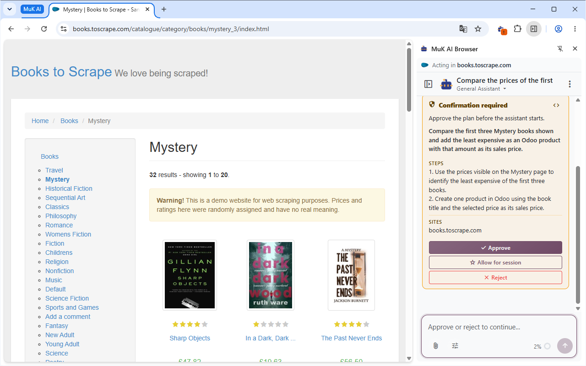
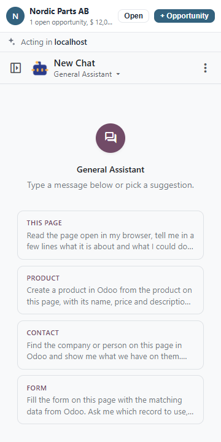
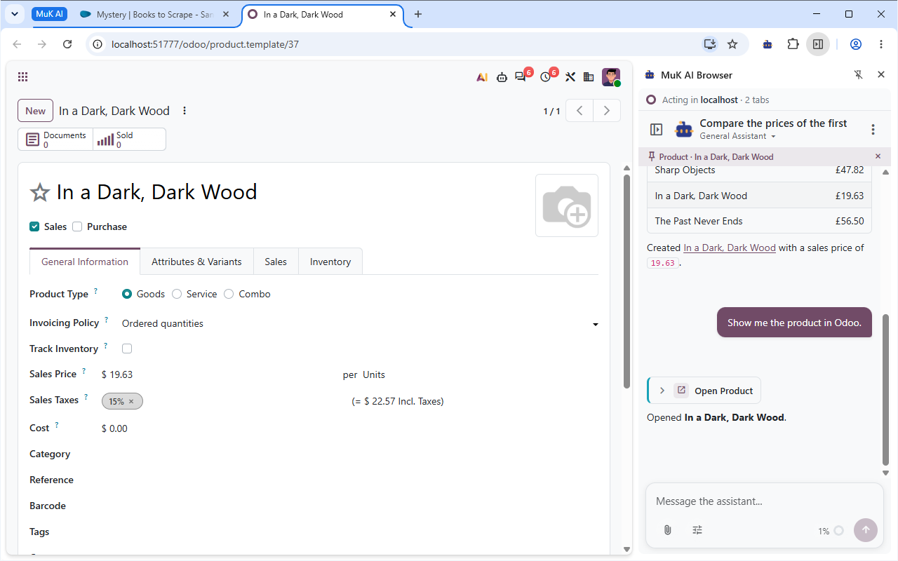
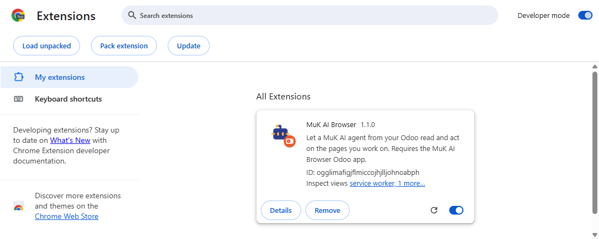
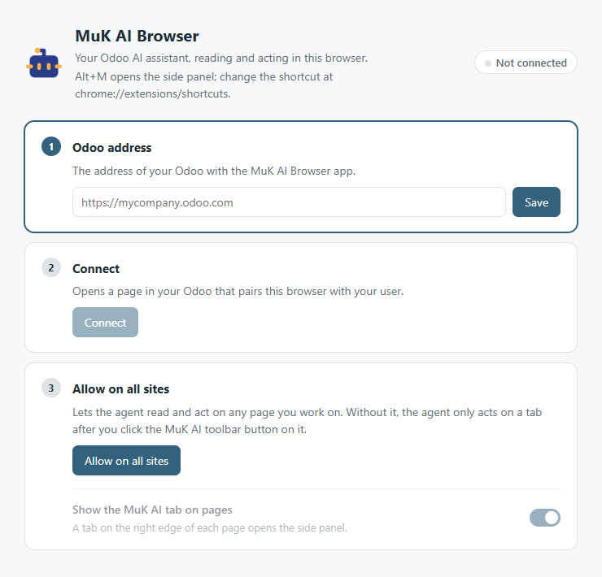

# MuK AI Browser


[](https://chromewebstore.google.com/detail/fecogbhcchendbojonbojofkiehdacne)
[](https://apps.odoo.com/apps/modules/muk_ai_browser)
[](https://youtu.be/ZcIvjovoFtg)
[](LICENSE)
[](https://www.mukit.at)

**Your Odoo AI assistant, in the browser next to it.** A Chrome extension that
lets a MuK AI agent from your Odoo read and act on the web pages you work on:
read a page, find elements, click, type, fill forms, navigate, compare tabs,
take screenshots, save files from a site to an Odoo record and put Odoo files
into a site's upload field. Chrome's side panel shows your Odoo's own MuK AI
chat; the agent, its approvals, the per-site rules and the audit trail live in
your Odoo.



It requires the **MuK AI Browser** Odoo app (`muk_ai_browser`, free under
LGPL-3) on Odoo 16.0 to 20.0. Built with [WXT](https://wxt.dev), TypeScript
and React.

## Features

- **The chat in the side panel**: the same chat, agents and tools as inside
  Odoo, beside any web page.
- **Reads, clicks, types**: reads the page, clicks, types, fills whole forms,
  scrolls and takes screenshots, in a tab group named "MuK AI".
- **Several tabs**: reads every tab of its group, for example to compare two
  offers, without switching to it.
- **The site in Odoo at a glance**: a bar above the chat names the company in
  your Odoo behind the site you look at, opens it, or offers to create it.
- **Selected text to the chat**: right-click a selection to ask about it or
  turn it into a contact; **Alt+M** opens the side panel.
- **Files both ways**: saves a PDF or image from a site onto an Odoo record,
  and puts an Odoo attachment into a site's upload field after you approve.
- **You stay in control**: a plan you approve for tasks of several steps,
  allow, ask or block per site in Odoo, and form submits, uploads and words
  like pay or delete always ask first. It never types into password, payment
  card or one-time code fields.

<p>
  
  
</p>

## Install

### From the Chrome Web Store

Add [MuK AI Browser](https://chromewebstore.google.com/detail/fecogbhcchendbojonbojofkiehdacne)
to Chrome (version 116 or newer) or to Microsoft Edge. Chrome keeps it up to
date.

### Without the Chrome Web Store

Use this for a browser that cannot reach the store, or to try a version before
it is published there. Chrome does not update an extension installed this
way; repeat the steps for a new version.

1. Download `muk-ai-browser-extension-<version>-chrome.zip` from the
   [latest release](https://github.com/muk-it/muk-ai-browser-extension/releases/latest)
   and unzip it into a folder you keep, for example
   `Documents/muk-ai-browser`. Chrome loads the extension from that folder
   every time it starts, so do not delete it.
2. Open `chrome://extensions` (in Edge: `edge://extensions`) and turn on
   **Developer mode**.
3. Click **Load unpacked** and choose the unzipped folder, the one that
   contains `manifest.json`.



A release build always has the id `ogglimafigjflmiccojhjlljohnoabph`. To
update it, replace the folder's content with the new release and click the
reload arrow on the extension's card.

### From the source

```bash
git clone https://github.com/muk-it/muk-ai-browser-extension.git
cd muk-ai-browser-extension
npm ci
npm run build
```

Then load `.output/chrome-mv3` with **Load unpacked** as above.

## Set up

1. Install the **MuK AI Browser** app (`muk_ai_browser`) in your Odoo; it
   needs **MuK AI** with an AI provider set up.
2. The extension's options page opens after the install (later: right-click
   the toolbar button, **Options**). It walks through three steps:
    1. **Odoo address**: `https://...` (`http://` only for `localhost`),
       resolving to one database. Saving asks Chrome for access to that site.
    2. **Connect**: opens `<odoo>/muk_ai_browser/connect`. Log in there; the
       extension reads the one-time code, pairs and closes the tab by itself.
       Elsewhere, paste the code into the side panel.
    3. **Allow on all sites** (optional): lets the agent act on any page and
       shows the MuK AI tab on pages, which can be turned off.
3. In Odoo, set what the agent may do on a site without a rule under
   **MuK AI > Settings > Extensions > Browser**, and the site rules under
   **MuK AI > Configuration > Site Permissions**.



If the address points to an Odoo without the app, the options page and the
side panel say so instead of opening a page the Odoo lacks.

## Use

Open the side panel with the toolbar button, with **Alt+M** (change it at
`chrome://extensions/shortcuts`), or with the MuK AI tab on the right edge of
a page (drag it up or down; it hides while the panel is open and never shows
on your Odoo). The panel shows the MuK AI chat of your Odoo with everything
installed there: agents, tools, approvals, skills and voice. It shows **Log in
to Odoo** or **Odoo is not reachable** until Odoo is ready.

The chat open in the panel is the one the agent acts for. While it is not
working, the agent follows the tab you look at; the bar above the chat names
that site, with a pulsing dot while the agent works, and a click brings the
tab to the front. Tabs the agent opens join a tab group named "MuK AI".

Above that bar the extension shows the company in your Odoo behind the site of
the agent's tab, with **Open** to show it in the tab group, or buttons such as
**+ Contact** that put a prompt into the chat. Odoo decides what the card
says; with MuK AI CRM it adds the open opportunities and the last order.

Right-click selected text for **MuK AI Browser > Ask MuK AI about this** or
**Create a contact from this**: the panel opens with the text quoted in the
chat's composer.

**Files.** `browser_save_file` downloads a file from a site (a link, an image,
or the PDF open in the tab) with your cookies for that site and attaches it
to an Odoo record. `browser_upload_file` puts an Odoo attachment into a site's
file field. Saving follows the site's rule like any other action; every
upload asks you first. Files larger than 20 MB are refused.

## Permissions

| Permission                          | Why                                                                                            |
| ----------------------------------- | ---------------------------------------------------------------------------------------------- |
| `sidePanel`                         | The Odoo chat is shown in Chrome's side panel.                                                 |
| `storage`                           | The Odoo address, the device key, the chat id and the launcher preferences.                    |
| `scripting`                         | Injects the page tools when the agent acts; registers the pairing reader and the launcher.     |
| `activeTab`                         | Lets the agent act on the tab where you clicked the toolbar button, without all-site access.   |
| `tabs`, `tabGroups`                 | Finds the agent's tab, opens and closes its own tabs and groups them as "MuK AI".              |
| `alarms`                            | Resumes polling Odoo after Chrome suspends the extension, only while a chat is active.         |
| `contextMenus`                      | The "Ask MuK AI about this" and "Create a contact from this" items on selected text.           |
| Your Odoo's address (asked on save) | Talks to your Odoo, checks the login and reads the pairing code on its connect page.           |
| All sites (optional)                | Lets the agent read and act on any page, and shows the MuK AI tab. Otherwise only `activeTab`. |

**Trusted input** (real input events through the debugger protocol) needs the
`debugger` permission, which Chrome does not allow as optional. The published
builds do not request it and answer `trusted: true` calls with
`trusted_input_unavailable`; add `debugger` to `permissions` in
`wxt.config.ts` for a build of your own that has it.

## Privacy

The extension talks only to the Odoo you configured. It sends the chat id, the
origin of the agent's tabs, the device label (e.g. `Chrome on Windows`), the
address of the agent's page for the card, and the results of the actions the
agent asks for (page outline, screenshots, URL and title, files it saves). It
reads pages only when the agent asks, only in the agent's tabs, and never
types into password, payment card or one-time code fields. It puts a file into
a site's upload field only after you approved it in Odoo. Your Odoo decides
per site whether the agent may act, must ask, or is blocked. The full policy
is in [store/PRIVACY.md](store/PRIVACY.md).

## Develop

```bash
npm ci                 # install
npm run dev            # watch build with reload
npm run build          # .output/chrome-mv3
npm run zip            # release zip with the fixed id
npm run zip:store      # Chrome Web Store zip, without the id key
npm test               # unit tests (vitest, jsdom)
npm run lint           # eslint
npm run format:check   # prettier
npx tsc --noEmit       # types
npm run e2e            # Playwright against the build and a fake Odoo
```

`e2e/live.spec.ts` runs against a real Odoo when `ODOO_URL` and `PAIR_CODE`
are set; `HEADED=1` shows the browser.

- `lib/`: logic with unit tests: Odoo client, attach and poll, tool routing
  and runner, perception, page actions, screenshots, trusted input, messages.
- `entrypoints/`: wiring. `background.ts` (service worker: pairing, Odoo
  checks, polling, card, context menu), `sidepanel/` (onboarding, the card
  and the embedded chat), `options/`, `content/` (page tools, injected on
  demand), `launcher.content.ts` and `pairing.content.ts` (registered at
  runtime).
- `store/`: the privacy policy and the Chrome Web Store images.

The Odoo side of the protocol (pairing, polling, tool results, the card) lives
in the `muk_ai_browser` app, in `controllers/browser.py`.

## Contributing

Issues and pull requests are welcome. Run `npm test`, `npm run lint`,
`npm run format:check` and `npx tsc --noEmit` before you open a pull request;
the CI runs the same checks. Report security issues privately, as described in
[SECURITY.md](SECURITY.md).

## License

Apache-2.0, see [LICENSE](LICENSE). The accessibility-tree code in
`lib/playwright-aria/` is adapted from Microsoft Playwright, also Apache-2.0
(see [NOTICE](NOTICE)). Maintained by [MuK IT GmbH](https://www.mukit.at),
Vienna.
