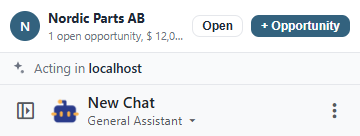

<p align="center">
  
</p>

<h1 align="center">MuK AI Browser</h1>

<p align="center">
  <strong>Your Odoo AI assistant, in the browser next to it.</strong><br>
  A Chrome extension that lets the MuK AI agent of your Odoo read and act on
  the web pages you work on.
</p>

<p align="center">
  <a href="https://chromewebstore.google.com/detail/fecogbhcchendbojonbojofkiehdacne"></a>
  <a href="https://apps.odoo.com/apps/modules/muk_ai_browser"></a>
  <a href="https://youtu.be/ZcIvjovoFtg"></a>
  <a href="LICENSE"></a>
  <a href="https://www.mukit.at"></a>
</p>


Chrome's side panel shows your Odoo's own MuK AI chat. The agent reads the
page, clicks, types, fills forms, compares tabs and moves files between the
web and Odoo; its approvals, the per-site rules and the log stay in your Odoo.
It needs the free **MuK AI Browser** app (`muk_ai_browser`) on Odoo 16.0 to
20.0.

## Features

- **The chat in the side panel**: the same chat, agents and tools as inside
  Odoo, beside any web page.
- **Reads, clicks, types**: reads the page, clicks, types, fills whole forms,
  scrolls and takes screenshots, in a tab group named "MuK AI".
- **Several tabs**: reads every tab of its group, for example to compare two
  offers, without switching to it.
- **The site in Odoo at a glance**: a bar above the chat names the company in
  your Odoo behind the site you look at, opens it, or offers to create it.
- **Selected text to the chat**: right-click a selection to ask about it or
  turn it into a contact; **Alt+M** opens the side panel.
- **Files both ways**: saves a PDF or image from a site onto an Odoo record,
  and puts an Odoo attachment into a site's upload field after you approve.
- **You stay in control**: a plan you approve for tasks of several steps,
  allow, ask or block per site, and form submits, uploads and words like pay
  or delete always ask first. It never types into password, payment card or
  one-time code fields.

## Install

**From the Chrome Web Store:** add
[MuK AI Browser](https://chromewebstore.google.com/detail/fecogbhcchendbojonbojofkiehdacne)
to Chrome 116 or newer, or to Microsoft Edge. Chrome keeps it up to date.

**Without the Chrome Web Store**, for a browser that cannot reach the store or
to try a version before it is published there:

1. Download `muk-ai-browser-extension-<version>-chrome.zip` from the
   [latest release](https://github.com/muk-it/muk-ai-browser-extension/releases/latest)
   and unzip it into a folder you keep. Chrome loads the extension from that
   folder every time it starts.
2. Open `chrome://extensions` (in Edge: `edge://extensions`) and turn on
   **Developer mode**.
3. Click **Load unpacked** and choose the unzipped folder, the one with
   `manifest.json` in it.


Chrome does not update an extension installed this way: for a new version,
replace the folder's content and click the reload arrow on the extension's
card. A release build always has the id `ogglimafigjflmiccojhjlljohnoabph`.

**From the source:** `npm ci` and `npm run build`, then load
`.output/chrome-mv3` with **Load unpacked**.

## Set up

1. Install **MuK AI Browser** in your Odoo; it needs **MuK AI** with an AI
   provider set up.
2. The extension's options page opens after the install. Enter your Odoo
   address, click **Connect** and log in to Odoo in the tab that opens: it
   pairs the browser and closes itself. **Allow on all sites** lets the agent
   act on any page.
3. In Odoo, set what the agent may do on a site without a rule under
   **MuK AI > Settings > Extensions > Browser**, and the site rules under
   **MuK AI > Configuration > Site Permissions**.


## Use

Open the side panel with the toolbar button, with **Alt+M**, or with the MuK
AI tab on the right edge of a page, and ask. While the agent is not working it
follows the tab you look at; the bar above the chat names that site, and tabs
the agent opens join a tab group named "MuK AI".

Above it, the extension names the company in your Odoo behind the site, with
**Open** to show it and buttons that put a prompt into the chat. With MuK AI
CRM the card adds the open opportunities and the last order.



Right-click selected text for **MuK AI Browser > Ask MuK AI about this** or
**Create a contact from this**. Files saved from a site go onto an Odoo record;
an Odoo file goes into a site's upload field only after you approve it.

## Permissions

| Permission                          | Why                                                                                            |
| ----------------------------------- | ---------------------------------------------------------------------------------------------- |
| `sidePanel`                         | The Odoo chat is shown in Chrome's side panel.                                                 |
| `storage`                           | The Odoo address, the device key, the chat id and the launcher preferences.                    |
| `scripting`                         | Injects the page tools when the agent acts; registers the pairing reader and the launcher.     |
| `activeTab`                         | Lets the agent act on the tab where you clicked the toolbar button, without all-site access.   |
| `tabs`, `tabGroups`                 | Finds the agent's tab, opens and closes its own tabs and groups them as "MuK AI".              |
| `alarms`                            | Resumes polling Odoo after Chrome suspends the extension, only while a chat is active.         |
| `contextMenus`                      | The "Ask MuK AI about this" and "Create a contact from this" items on selected text.           |
| Your Odoo's address (asked on save) | Talks to your Odoo, checks the login and reads the pairing code on its connect page.           |
| All sites (optional)                | Lets the agent read and act on any page, and shows the MuK AI tab. Otherwise only `activeTab`. |

## Privacy

The extension talks only to the Odoo you configured, contains no analytics,
reads pages only when the agent asks, and never types into password, payment
card or one-time code fields. What it sends to your Odoo is listed in the
[privacy policy](store/PRIVACY.md).

## Develop

```bash
npm ci && npm run build   # .output/chrome-mv3
npm test                  # unit tests
```

[Development](docs/DEVELOPMENT.md) has the checks, the end-to-end tests, the
layout, the code style and the release steps;
[Architecture](docs/ARCHITECTURE.md) explains how the extension and the Odoo
app work together.

## Contributing

Issues and pull requests are welcome; the CI checks every pull request. Report
security issues privately, as described in [SECURITY.md](SECURITY.md).

## License

Apache-2.0, see [LICENSE](LICENSE). The accessibility-tree code in
`lib/playwright-aria/` is adapted from Microsoft Playwright, also Apache-2.0
(see [NOTICE](NOTICE)). Maintained by [MuK IT GmbH](https://www.mukit.at),
Vienna.
